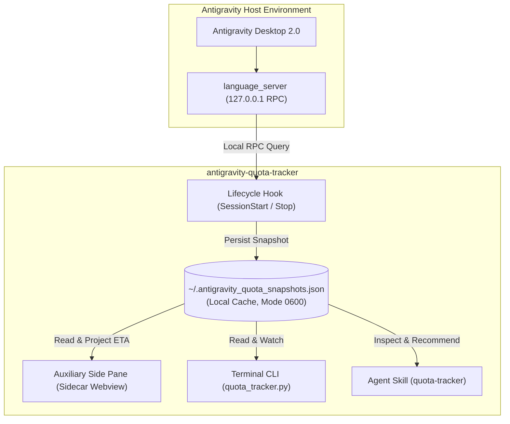

# Antigravity Quota Tracker & Multi-Account Cache

[](https://github.com/dmoreq/antigravity-quota-tracker/actions/workflows/ci.yml)
[](https://opensource.org/licenses/MIT)
[](https://antigravity.google)

> **English** | [Tiếng Việt](README.vi.md)

A native plugin built for the **Google Antigravity Customization System** (Antigravity 2.0 Desktop & CLI). It automatically tracks, caches, and compares AI model rate limits across multiple Antigravity Pro accounts, complete with real-time offline replenishment countdowns, model multi-filtering, and intelligent account switch recommendations.

---

## Architecture Overview



---

## Key Features

1. **Native Auxiliary Side Pane Webview**:
   - Integrates directly into Antigravity Desktop's side panel via `sidecar://quota-cache/quota-ui/`.
   - **Antigravity 2.0 Native Theme**: Dynamically inherits `--vscode-*` CSS tokens, automatically adapting to light, dark, and custom editor themes.
   - **Model Multi-Select Filters**: Filter by **Gemini**, **Argon**, or **Claude** (defaults to Gemini + Argon).
   - **Live Countdown Ticker**: Second-by-second countdown until quota replenishes, formatted cleanly in local time.
   - **Account Detail Drawer**: Slide-over panel with model breakdowns and switch diagnostics.

2. **Automatic Lifecycle Hooks (`hooks.json`)**:
   - Runs silently on `SessionStart` and `Stop` events.
   - Queries the local `language_server` on `127.0.0.1` (`GetUserStatus` and `RetrieveUserQuotaSummary`).
   - Automatically records current account quota into `~/.antigravity_quota_snapshots.json`.

3. **Offline Replenishment Projection**:
   - When switching accounts, previously cached accounts remain tracked.
   - The plugin mathematically calculates recovery ETAs offline and updates the status to `🟢 100% (Replenished)` as soon as the reset timestamp passes—no re-login required.

4. **100% Safe & Localhost-Only**:
   - Zero external HTTP requests or telemetry.
   - Never reads or stores auth tokens, cookies, passwords, or Keychain entries.
   - Snapshots are written atomically with strict `0600` POSIX file permissions (accessible solely by your local user account).

5. **Agent Skill (`quota-tracker`)**:
   - Ask your agent directly in chat: *"Check quota"*, *"Which account is ready?"*, or type `/quota`.

6. **Terminal CLI Dashboard**:
   - Full-featured command-line utility with `--watch`, `--full`, and `--json` flags.

---

## Directory Structure

```text
antigravity-quota-tracker/
├── .github/
│   └── workflows/
│       └── ci.yml               # Multi-version Python & Node syntax CI
├── bin/
│   └── quota_tracker.py         # Standalone Terminal CLI dashboard
├── hooks/
│   └── record_snapshot.py       # Hook script for RPC capture
├── sidecars/
│   ├── quota-ui.zip             # Packaged auxiliary webview
│   └── quota-ui/                # Webview source (HTML/CSS/JS/Node)
│       ├── sidecar.json         # Antigravity sidecar registration
│       ├── server.cjs           # Lightweight localhost server
│       ├── index.html           # Dashboard layout
│       ├── app.js               # Reactive render & countdown engine
│       └── styles.css           # Native Antigravity CSS tokens
├── skills/
│   └── quota-tracker/
│       └── SKILL.md             # Antigravity agent skill definition
├── tests/                       # Pytest unit test suite
├── hooks.json                   # Lifecycle hook configuration
├── plugin.json                  # Plugin manifest
├── pyproject.toml               # Project metadata & test configs
└── LICENSE                      # MIT License
```

---

## Installation

### Prerequisites
- Google Antigravity 2.0 (or Antigravity CLI `agy`)
- Python 3.8+ (stdlib only, zero third-party dependencies required)
- Node.js (for running the sidecar webview backend)

### Step-by-Step Setup

1. **Clone the repository**:
   ```bash
   git clone https://github.com/dmoreq/antigravity-quota-tracker.git ~/Workspace/personal/antigravity-quota-tracker
   ```

2. **Symlink into Antigravity Plugins directory**:
   ```bash
   mkdir -p ~/.gemini/config/plugins
   ln -sfn "$HOME/Workspace/personal/antigravity-quota-tracker" ~/.gemini/config/plugins/quota-cache
   ```

3. **Restart or reload Antigravity**:
   The plugin, lifecycle hooks, and agent skill will activate automatically.

---

## Usage

### 1. Auxiliary Side Pane
Open the quota panel in your Antigravity side pane by clicking the link in any conversation:
> [Open Quota Dashboard](sidecar://quota-cache/quota-ui/)

Keyboard shortcuts inside the webview:
- `1`, `2`, `3`: Toggle Gemini, Argon, and Claude filters.
- `⌘K` / `Ctrl+K`: Focus search bar.
- `R`: Refresh data.
- `Esc`: Close detail drawer or clear search.

### 2. Terminal CLI
```bash
# Standard compact dashboard
python3 ~/.gemini/config/plugins/quota-cache/bin/quota_tracker.py

# Full view (all 5h and weekly pools for Gemini, Claude, Argon)
python3 ~/.gemini/config/plugins/quota-cache/bin/quota_tracker.py --full

# Live auto-refreshing watch mode (every 15s)
python3 ~/.gemini/config/plugins/quota-cache/bin/quota_tracker.py --watch 15

# Export raw JSON snapshot
python3 ~/.gemini/config/plugins/quota-cache/bin/quota_tracker.py --json
```

### 3. Agent Prompts
Type in any Antigravity chat:
- `"Check quota"`
- `"Which account has replenished?"`
- `"/quota"`

---

## Running Tests

Run the unit test suite locally:

```bash
pip install pytest
pytest tests/ -v
```

---

## Security & Privacy

- **Localhost Bound**: All communication strictly stays on `127.0.0.1` between Antigravity and the plugin scripts.
- **Zero Credentials**: No passwords, OAuth refresh tokens, or API secrets are accessed or persisted.
- **POSIX Protection**: Cache files are created with mode `0600` (`-rw-------`).

---

## License

This project is licensed under the [MIT License](LICENSE) - see the LICENSE file for details.
