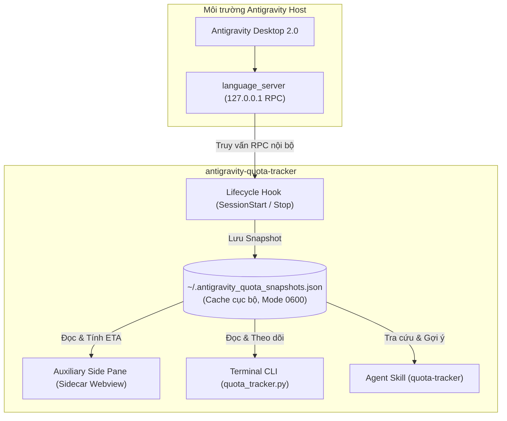

# Antigravity Quota Tracker & Bộ Nhớ Đệm Đa Tài Khoản

[](https://github.com/dmoreq/antigravity-quota-tracker/actions/workflows/ci.yml)
[](https://opensource.org/licenses/MIT)
[](https://antigravity.google)

> [English](README.md) | **Tiếng Việt**

Plugin chính thức theo kiến trúc **Antigravity Customization System** (tương thích Antigravity 2.0 Desktop và Antigravity CLI `agy`), giúp tự động lưu cache thông tin hạn mức (Quota) của nhiều tài khoản khi bạn chuyển đổi qua lại giữa các account trên Antigravity Desktop App. Plugin tích hợp bộ đếm ngược thời gian hồi quota ngoại tuyến (offline replenishment countdown) và đề xuất tài khoản thay thế thông minh.

---

## Kiến Trúc Tổng Thể



---

## Tính Năng Nổi Bật

1. **Giao Diện Auxiliary Side Pane Trực Quan**:
   - Tích hợp trực tiếp vào thanh bên (Auxiliary Side Pane) của Antigravity Desktop qua giao thức `sidecar://quota-cache/quota-ui/`.
   - **Tương thích màu Antigravity 2.0**: Kế thừa trực tiếp biến CSS gốc `--vscode-*`, tự động chuyển đổi theo theme Light, Dark hoặc theme mở rộng của Antigravity.
   - **Bộ lọc Multi-select**: Lọc linh hoạt theo **Gemini**, **Argon**, hoặc **Claude** (mặc định chọn sẵn Gemini + Argon).
   - **Live Countdown Ticker**: Bộ đếm ngược thời gian hồi (ETA) nhảy mượt mà từng giây theo giờ địa phương mà không cần reload trang.
   - **Drawer Chi Tiết**: Bảng trượt xem thông số từng model pool và khuyến nghị switch tài khoản.

2. **Tự Động Snapshot Qua Lifecycle Hooks (`hooks.json`)**:
   - Tự động chạy ngầm mỗi khi bạn mở phiên chat (`SessionStart`) hoặc khi agent kết thúc lượt trả lời (`Stop`).
   - Kết nối trực tiếp qua RPC nội bộ `127.0.0.1` của Official Desktop App (`GetUserStatus` & `RetrieveUserQuotaSummary`).
   - Tự động lưu và cập nhật tài khoản đang active vào file snapshot `~/.antigravity_quota_snapshots.json`.

3. **Tính Toán Giờ Hồi Ngoại Tuyến (Offline Replenishment)**:
   - Khi bạn chuyển sang tài khoản khác, tài khoản cũ vẫn được lưu trong cache.
   - Tự động chuyển trạng thái thành `🟢 100% (Đã hồi đầy)` ngay khi vượt qua mốc giờ reset mà không cần phải đăng nhập lại.

4. **An Toàn 100% (Safe & Localhost Only)**:
   - Tuyệt đối KHÔNG gửi request ra ngoài Internet hay thu thập telemetry.
   - Tuyệt đối KHÔNG đọc token xác thực, Keychain hay lưu mật khẩu.
   - File snapshot được phân quyền bảo mật POSIX `0600` (chỉ user hiện tại có quyền đọc/ghi).

5. **Skill Tích Hợp Sẵn Cho Agent (`quota-tracker`)**:
   - Bạn chỉ cần hỏi agent: *"Xem quota hiện tại"*, *"Account nào đã hồi?"*, hoặc gõ `/quota`, agent sẽ tự động hiển thị bảng so sánh trực quan.

6. **CLI Dashboard Trong Terminal**:
   - Công cụ dòng lệnh độc lập hỗ trợ các cờ `--watch`, `--full`, và `--json`.

---

## Cấu Trúc Thư Mục

```text
antigravity-quota-tracker/
├── .github/
│   └── workflows/
│       └── ci.yml               # CI tự động test đa phiên bản Python & Node
├── bin/
│   └── quota_tracker.py         # CLI Dashboard xem quota trực tiếp trong Terminal
├── hooks/
│   └── record_snapshot.py       # Script ghi nhận snapshot tự động qua Localhost RPC
├── sidecars/
│   ├── quota-ui.zip             # Gói webview đóng gói sẵn
│   └── quota-ui/                # Mã nguồn Sidecar Webview (HTML/CSS/JS/Node)
│       ├── sidecar.json         # Đăng ký sidecar với Antigravity
│       ├── server.cjs           # Node.js HTTP backend (thuần stdlib)
│       ├── index.html           # HTML dashboard
│       ├── app.js               # Reactive logic render & bộ đếm countdown
│       └── styles.css           # Theme tokens tương thích Antigravity
├── skills/
│   └── quota-tracker/
│       └── SKILL.md             # Hướng dẫn Agent tra cứu & đề xuất switch
├── tests/                       # Bộ kiểm thử đơn vị Pytest
├── hooks.json                   # Khai báo lifecycle hooks
├── plugin.json                  # Khai báo plugin metadata cho Antigravity
├── pyproject.toml               # Cấu hình project & test
└── LICENSE                      # Giấy phép MIT
```

---

## Cài Đặt & Kích Hoạt

### Yêu Cầu Hệ Thống
- Google Antigravity 2.0 (hoặc Antigravity CLI `agy`)
- Python 3.8+ (chỉ dùng thư viện chuẩn, không cần pip install)
- Node.js (để chạy backend cho auxiliary webview)

### Các Bước Cài Đặt

1. **Clone mã nguồn**:
   ```bash
   git clone https://github.com/dmoreq/antigravity-quota-tracker.git ~/Workspace/personal/antigravity-quota-tracker
   ```

2. **Liên kết plugin vào Antigravity**:
   ```bash
   mkdir -p ~/.gemini/config/plugins
   ln -sfn "$HOME/Workspace/personal/antigravity-quota-tracker" ~/.gemini/config/plugins/quota-cache
   ```

3. **Khởi động lại Antigravity**:
   Plugin, lifecycle hooks, và skill sẽ tự động kích hoạt.

---

## Sử Dụng

### 1. Mở Giao Diện Trên Thanh Bên (Auxiliary Side Pane)
Bấm vào link sau trong bất kỳ phiên chat nào:
> [Mở Quota Dashboard](sidecar://quota-cache/quota-ui/)

Phím tắt trong giao diện:
- `1`, `2`, `3`: Bật/tắt nhanh filter Gemini, Argon, Claude.
- `⌘K` / `Ctrl+K`: Focus ô tìm kiếm.
- `R`: Làm mới dữ liệu.
- `Esc`: Đóng bảng chi tiết hoặc xóa tìm kiếm.

### 2. Sử Dụng CLI Trong Terminal
```bash
# Xem bảng quota hiện tại của các tài khoản đã cache
python3 ~/.gemini/config/plugins/quota-cache/bin/quota_tracker.py

# Xem chi tiết toàn bộ các bể (Gemini, Claude, Argon, Weekly)
python3 ~/.gemini/config/plugins/quota-cache/bin/quota_tracker.py --full

# Chế độ theo dõi tự động làm mới mỗi 15 giây
python3 ~/.gemini/config/plugins/quota-cache/bin/quota_tracker.py --watch 15

# Xuất dữ liệu snapshot dạng JSON
python3 ~/.gemini/config/plugins/quota-cache/bin/quota_tracker.py --json
```

### 3. Hỏi Trực Tiếp Agent
Trong khung chat Antigravity, bạn có thể gõ:
- `"Xem quota hiện tại"`
- `"Account nào đã hồi?"`
- `"/quota"`

---

## Kiểm Thử (Running Tests)

Chạy bộ kiểm thử đơn vị:

```bash
pip install pytest
pytest tests/ -v
```

---

## Bảo Mật & Riêng Tư

- **Chỉ kết nối Localhost**: Toàn bộ luồng giao tiếp diễn ra nội bộ trên `127.0.0.1`.
- **Không lưu Credential**: Không đọc hay lưu mật khẩu, OAuth token, hay API key.
- **Phân quyền POSIX Chặt Chẽ**: File cache được ghi với quyền `0600` (`-rw-------`).

---

## Giấy Phép (License)

Dự án được phát hành theo giấy phép [MIT License](LICENSE).
